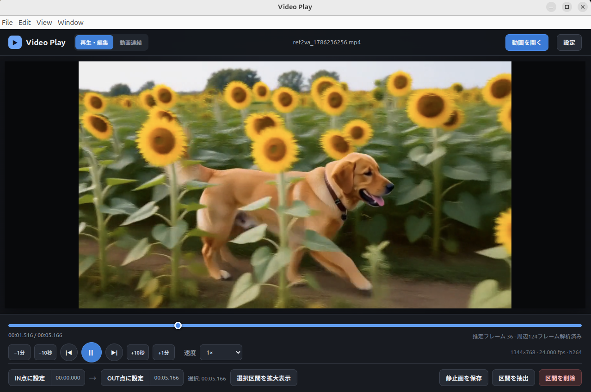

# Video-player

WindowsとLinuxで動作する、MP4動画の再生・簡易編集用デスクトップアプリです。

## ダウンロード

- [最新版リリース](https://github.com/animede/video-play/releases/latest)
- [v0.2.0 リリースページ](https://github.com/animede/video-play/releases/tag/v0.2.0)
- [Windows (v0.2.0) 直接ダウンロード](https://github.com/animede/video-play/releases/download/v0.2.0/Video-player-0.2.0-Windows-x64.exe)
- [Linux AppImage (v0.2.0) 直接ダウンロード](https://github.com/animede/video-play/releases/download/v0.2.0/Video-player-0.2.0-Linux-x86_64.AppImage)
- [Linux deb (v0.2.0) 直接ダウンロード](https://github.com/animede/video-play/releases/download/v0.2.0/Video-player-0.2.0-Linux-amd64.deb)

## GUI見本

再生・編集タブの画面例です。



## 機能

- MP4ファイルの選択とドラッグ＆ドロップ
- 0.25～4倍の8段階の再生速度
- 前後の正確なコマ送り（周辺PTSをオンデマンド解析し、停止中はFFmpegで対象フレームを表示）
- 表示中フレームのPNG/JPEG保存
- IN点・OUT点を使った区間抽出
- 複数の削除区間を指定し、一度の処理で除去した新しいMP4を生成
- 複数MP4のドロップ順連結とサムネイル一覧
- ウインドウに合わせたアスペクト比維持リサイズ
- 編集進捗表示とキャンセル
- GPUエンコーダー（NVIDIA NVENC・Intel Quick Sync・AMD AMF）の自動検出とCPUフォールバック
- 高速・標準・高画質のエンコード品質設定

編集結果は常に新しいファイルへ保存し、元動画は変更しません。

動画本体は全体をメモリへ読み込まず、ChromiumとFFmpegがディスクから順次読み出します。正確なコマ送り用の解析も30秒単位で行い、現在位置の前後だけを最大3区間キャッシュするため、1GBを超える長時間動画でも初回に全フレームを走査しません。

コマ送り時は解析済みの正確なPTSを使い、FFmpegが対象と前後各2フレームを1プロセスで高品質JPEGへデコードして動画表示の上に重ねます。表示用画像は最大12フレームのLRUキャッシュへ保持するため、連続移動や往復ではFFmpegの再実行を抑えます。周辺PTSが未解析の場合は解析完了を待ち、平均FPSによる推定移動は行いません。再生を再開すると通常のストリーミング再生へ戻ります。静止画ファイルとして保存する場合は従来どおりPNG/JPEGを選択できます。

「動画連結」タブでは、複数のMP4をドロップするとサムネイルがドロップ順に表示されます。「すべての動画を連結」を押すと、先頭動画の解像度とFPSへ揃えてH.264/AACのMP4を生成します。縦横比が異なる動画には黒帯を追加し、音声のない動画には無音を補って同期を維持します。

## エンコード高速化の仕様

区間抽出、複数区間削除、動画連結では、設定画面の「エンコード方式」と「品質」を使用します。初期設定の「自動（GPU優先）」では、FFmpegにエンコーダー名が存在するだけでなく、64×64ピクセルの短い試験エンコードに成功した方式だけを利用可能と判定します。

自動選択の優先順位は次のとおりです。

1. NVIDIA NVENC（`h264_nvenc`）
2. Intel Quick Sync（`h264_qsv`）
3. AMD AMF（`h264_amf`）
4. CPU（`libx264`）

GPUがない場合、対応ドライバーがない場合、または同梱FFmpegがGPUエンコーダーを含まない場合は、自動的にCPUを使用します。GPUが検出後の本処理で失敗した場合も、不完全な出力ファイルを削除してCPU処理へフォールバックします。

品質設定とCPU使用時の設定は次のとおりです。GPU使用時にも、それぞれに相当する速度・品質設定を適用します。

| 品質 | CPU設定 | 用途 |
| --- | --- | --- |
| 高速 | `libx264 / ultrafast / CRF 23` | 処理時間を最優先 |
| 標準（推奨） | `libx264 / veryfast / CRF 20` | 速度と画質のバランス |
| 高画質 | `libx264 / medium / CRF 18` | 画質を優先する従来相当の設定 |

この高速化は、指定フレームの位置を維持する再エンコード方式です。再エンコードを行わないストリームコピー方式ではないため、処理後の映像はH.264、音声はAACになります。複数区間削除では、残す区間だけを個別にシークして一度の処理で連結し、長い削除区間を不要にデコードしない構成です。

## 必要環境

- Node.js 26.x（`.nvmrc`でメジャーバージョンを固定。26.7などの26系を使用できます）
- npm 11以降

FFmpegとffprobeはnpm依存パッケージとしてOS別バイナリが入り、アプリにも同梱されます。開発時に別のバイナリを使う場合は、`VIDEO_PLAY_FFMPEG`と`VIDEO_PLAY_FFPROBE`に絶対パスを設定できます。

## 開発

```bash
npm install
npm run dev
```

キーボードではSpaceで再生・一時停止、左右矢印で前後のコマへ移動できます。

### Windowsでのセットアップに関する注意

PowerShellでは、実行ポリシーによって`npm.ps1`が拒否されることがあります。実行ポリシーを変更せず、次のように`npm.cmd`を使用できます。

```powershell
node --version
npm.cmd --version
npm.cmd ci --include=dev
npm.cmd run dev
```

`npm run dist:win`で「`tsc`が認識されない」などのエラーが表示される場合は、ビルドに必要な`devDependencies`がインストールされていません。プロジェクトフォルダで以下を実行してください。`tsc`をグローバルインストールする必要はありません。

```powershell
Remove-Item Env:NODE_ENV -ErrorAction SilentlyContinue
Remove-Item Env:NPM_CONFIG_PRODUCTION -ErrorAction SilentlyContinue

npm.cmd config delete omit
npm.cmd ci --include=dev
.\node_modules\.bin\tsc.cmd --version
npm.cmd run typecheck
npm.cmd run dist:win
```

`npm.cmd ci --include=dev`が失敗する場合は、代わりに以下を使用してください。

```powershell
npm.cmd install --include=dev
npm.cmd run dist:win
```

「`npm`はコマンドレット、関数、スクリプトファイル、または実行可能なプログラムとして認識されません」と表示される場合は、Node.js 26.xがインストールされていることを確認し、PowerShellをすべて閉じてから開き直してください。

### Windows側で再ビルドする手順

すでにWindowsへリポジトリを取得済みの場合は、Video-playerを終了してからプロジェクトフォルダをPowerShellで開き、以下を順番に実行します。Linux側で作成した`node_modules`やビルド成果物は持ち込まず、Windows側で依存パッケージをインストールしてください。

```powershell
# 1. 最新のソースを取得
git switch main
git pull --ff-only origin main

# 2. Node.jsのバージョンを確認
node --version
npm.cmd --version

# 3. package-lock.jsonに従ってWindows用依存パッケージを再インストール
Remove-Item Env:NODE_ENV -ErrorAction SilentlyContinue
Remove-Item Env:NPM_CONFIG_PRODUCTION -ErrorAction SilentlyContinue
npm.cmd ci --include=dev

# 4. 型チェックとテスト
npm.cmd run typecheck
npm.cmd test

# 5. Windows用NSISインストーラーを生成
npm.cmd run dist:win
```

生成されたインストーラーは、プロジェクト内の`release`フォルダにある`Video-player-<バージョン>-Windows-<アーキテクチャ>.exe`です。再ビルド前の`release`フォルダを削除する必要はありませんが、同じバージョンの成果物は置き換えられます。

ローカルに未コミットの変更があると`git pull --ff-only`が失敗する場合があります。その場合は変更をコミットまたは退避してから再実行してください。`npm.cmd ci`でファイル使用中のエラーが出る場合は、起動中のVideo-player、開発サーバー、Electronを終了してから実行します。

### WindowsへGPU対応FFmpegをインストールする

`ffmpeg-static`が提供するWindows用FFmpegにGPUエンコーダーが含まれていない環境では、NVIDIA GPUがあり`nvidia-smi`が動作していても、Video-playerにはCPUだけが表示されます。`ffmpeg.exe -version`に`ESSENTIAL`と表示され、次の確認で何も表示されない場合が該当します。

```powershell
ffmpeg.exe -hide_banner -encoders 2>&1 |
  Select-String "h264_nvenc|h264_qsv|h264_amf"
```

Windows Package ManagerでGyan FFmpeg Essentials版が入っている場合は削除し、Full版をインストールします。

```powershell
winget list FFmpeg
winget uninstall --exact --id Gyan.FFmpeg.Essentials
winget install --exact --id Gyan.FFmpeg
```

Essentials版がインストールされていなければ、アンインストールコマンドの失敗は問題ありません。インストール後はPowerShellをすべて閉じ、新しいPowerShellで使用される実行ファイルとGPUエンコーダーを確認します。

```powershell
ffmpeg.exe -version
(Get-Command ffmpeg.exe).Source
ffmpeg.exe -hide_banner -encoders 2>&1 |
  Select-String "h264_nvenc|h264_qsv|h264_amf"
```

古いFFmpegが優先される場合は、候補をすべて確認します。

```powershell
Get-Command ffmpeg.exe -All | Select-Object Source
```

開発版で一時的に試す場合は、Full版FFmpegのパスを現在のPowerShellへ設定してから起動します。この設定はPowerShellを閉じると解除されます。

```powershell
$env:VIDEO_PLAY_FFMPEG = (Get-Command ffmpeg.exe).Source
npm.cmd run dev
```

インストール版をアプリアイコンから起動するときも使用する場合は、ユーザー環境変数として保存します。設定後はWindowsから一度サインアウトして再度サインインし、Video-playerを起動してください。

```powershell
$ffmpegPath = (Get-Command ffmpeg.exe).Source
[Environment]::SetEnvironmentVariable("VIDEO_PLAY_FFMPEG", $ffmpegPath, "User")
```

Video-playerの設定画面に「NVIDIA NVENC」「Intel Quick Sync」「AMD AMF」など、試験エンコードに成功した方式が表示されれば設定完了です。NVIDIAを使う場合は「自動（GPU優先）」または「NVIDIA NVENC」を選び、Windowsのタスクマネージャーにある「パフォーマンス」→「GPU」→「Video Encode」で動作を確認できます。

## 検証

```bash
npm run typecheck
npm test
npm run build
```

## 配布パッケージ

対象OS上で以下を実行します。

```bash
# Windows（NSISインストーラー）
npm run dist:win

# Linux（AppImageとdebパッケージ）
npm run dist:linux
```

成果物は`release/`に生成されます。Windows版はWindows環境、Linux版はLinux環境でビルド・動作確認してください。

### Linuxでアイコンから起動する

アプリ一覧へ登録してアイコンから起動する場合は、生成されたdebパッケージをインストールします。

```bash
cp "release/Video-player-0.2.0-Linux-amd64.deb" /tmp/video-player-0.2.0-amd64.deb
sudo apt install /tmp/video-player-0.2.0-amd64.deb
```

ホームディレクトリを他ユーザーが参照できない環境では、`release`内のdebをAPTへ直接指定すると、`_apt`ユーザーからアクセスできないという通知が表示されます。これはパッケージ自体の権限エラーではありません。上記のように一度`/tmp`へコピーすると、APTのサンドボックスを保ったままインストールできます。

インストール後、デスクトップ環境のアプリ一覧で「Video-player」を検索して起動できます。アンインストールする場合は`sudo apt remove video-play`を実行します。

AppImage版はインストール不要です。ファイルマネージャーで実行権限を付けるか、次のコマンドを一度実行した後、`release`内のAppImageをダブルクリックして起動できます。

```bash
chmod +x "release/Video-player-0.2.0-Linux-x86_64.AppImage"
```

## 対応範囲

入力はMP4コンテナです。編集結果は映像をH.264、音声をAACへ再エンコードするため、指定位置のフレーム精度と音声同期を優先します。入力動画のコーデックをChromiumが再生できない場合は、アプリ内プレビューができません。

## FFmpegについて

本アプリは`ffmpeg-static`および`ffprobe-static`から提供されるFFmpeg関連バイナリを利用します。配布時には各パッケージおよびFFmpegのライセンス条件を確認し、必要なライセンス文書とソース提供案内を添付してください。

## ライセンス

本リポジトリのソースコードは [Apache License 2.0](LICENSE) で提供します。
著作権者: © 2026 YUZUKI (animede)。著作権表示と [NOTICE](NOTICE) の内容は、再配布時も保持してください。
モデルや依存ライブラリ等には各配布元のライセンスが別途適用されます。
